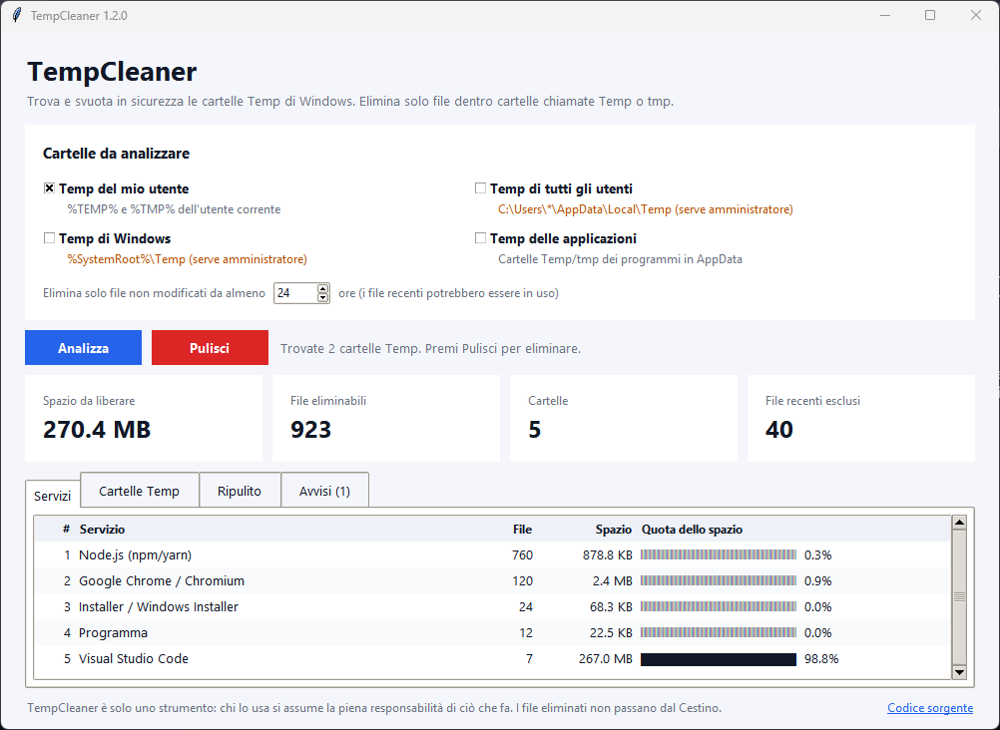

# TempCleaner

> [!WARNING]
> **TempCleaner è solo uno strumento: chi lo usa si assume la piena responsabilità di quello che fa.**
> I file vengono eliminati in modo definitivo. Usalo solo su computer tuoi o che sei autorizzato ad amministrare.
> Leggi l'[esclusione di responsabilità](DISCLAIMER.md) prima dell'uso.

Pulitore di file temporanei per **Windows**, da riga di comando.
Trova da solo le cartelle `Temp`, mostra cosa contengono e quali programmi le riempiono, poi elimina i file vecchi dopo la tua conferma.

> **English summary:** a small, dependency-free Python CLI that auto-discovers Windows temp folders, shows which apps fill them, and deletes old temp files after confirmation. It only ever touches folders named `Temp`/`tmp`. MIT licensed.



## Download e avvio (il modo più semplice)

1. Scarica **[TempCleaner.zip](https://github.com/makaDv/TempCleaner/releases/latest/download/TempCleaner.zip)** dalla pagina [Releases](https://github.com/makaDv/TempCleaner/releases/latest).
2. Tasto destro sullo zip → **Estrai tutto**.
3. Apri la cartella: il primo file è **`Avvia TempCleaner.cmd`**. Fai doppio clic: si apre la finestra di TempCleaner.
4. Scegli le cartelle e premi **Analizza**: vedi spazio occupato, servizi che creano più file e cartelle trovate.
5. Premi **Pulisci**, spunta la casella di assunzione di responsabilità e conferma.

Serve **Python 3.9 o superiore**. Se manca, il file di avvio propone di installarlo con `winget`, lo strumento ufficiale di Microsoft.

> **Perché non c'è un .exe?** Windows 11 con *Smart App Control* blocca ogni .exe che non ha una firma digitale a pagamento.
> TempCleaner invece parte con Python, che è firmato dalla Python Software Foundation, e il file di avvio è testo che puoi leggere con il Blocco note.
> Se compare "Apri file - Avviso di sicurezza", clicca **Esegui**. Per evitarlo, prima di estrarre: tasto destro sullo zip → **Proprietà** → spunta **Sblocca**.
> Per controllare che lo zip non sia stato alterato, confronta il suo hash con `TempCleaner.zip.sha256` nella release:
> ```powershell
> Get-FileHash .\TempCleaner.zip -Algorithm SHA256
> ```

Per pulire anche `Windows\Temp` e le Temp degli altri utenti: tasto destro su `Avvia TempCleaner.cmd` → **Esegui come amministratore**, poi scegli `all` nel menu.

## Cosa fa

- **Trova le cartelle Temp da solo**, in quattro gruppi combinabili:
  | Scope | Cartelle | Permessi |
  |---|---|---|
  | `user` | `%TEMP%`, `%TMP%`, `%LOCALAPPDATA%\Temp` | utente normale |
  | `users` | `C:\Users\*\AppData\Local\Temp` di tutti i profili | amministratore |
  | `system` | `%SystemRoot%\Temp` | amministratore |
  | `apps` | sottocartelle `Temp`/`tmp` delle applicazioni in `%LOCALAPPDATA%` e `%APPDATA%` | utente normale |
- **Mostra un'anteprima**: file, cartelle e spazio per ogni cartella Temp.
- **Classifica i servizi** che creano più file temporanei e quelli che occupano più spazio (Chrome, Edge, VS Code, npm, pip, Teams, Discord, Windows Installer, ecc.).
- **Chiede di accettare la responsabilità** (scrivendo `ACCETTO`) e poi la conferma, quindi elimina poi stampa un riepilogo: spazio liberato, file eliminati, file saltati e contenuto ripulito.

## Cosa NON fa

- Non tocca **nessuna** cartella che non si chiami `Temp` o `tmp`.
- Non elimina mai la cartella Temp stessa, solo il suo contenuto.
- Non segue collegamenti simbolici né junction: un collegamento dentro Temp che punta altrove viene ignorato.
- Di default non tocca i file modificati nelle ultime 24 ore, che potrebbero essere in uso.
- I file aperti da altri programmi vengono saltati, senza forzature.
- Nessuna connessione di rete, nessuna telemetria, nessuna modifica al registro, nessuna richiesta automatica di privilegi.

## Requisiti

- Windows 10 o 11
- Python 3.9 o superiore. Nessuna libreria esterna.

## Versione testuale e uso da Python

Senza parametri si apre la finestra grafica. Con qualsiasi parametro (oppure con `--cli`) parte la versione testuale nel terminale.

```bash
git clone https://github.com/makaDv/TempCleaner.git
cd TempCleaner
pip install .        # facoltativo: aggiunge il comando "tempcleaner"
```

## Uso

```bash
python -m tempcleaner                  # finestra grafica
python -m tempcleaner --cli            # versione testuale con menu
python -m tempcleaner -s user          # solo il Temp dell'utente corrente
python -m tempcleaner -s user,apps     # più scope insieme
python -m tempcleaner -s all           # tutto (avvia il terminale come amministratore)
python -m tempcleaner -s user -n       # solo anteprima, non elimina nulla
python -m tempcleaner -s user -y --accept-responsibility   # elimina senza domande
python -m tempcleaner -s user -a 72    # solo file più vecchi di 72 ore
python -m tempcleaner -s user --json   # output JSON per script
```

Dalla cartella della repo funziona anche il doppio clic su `Avvia TempCleaner.cmd`. Le stesse opzioni si possono passare al file di avvio, ad esempio `"Avvia TempCleaner.cmd" -s user -n`.

| Opzione | Descrizione |
|---|---|
| `-s, --scope` | `user`, `users`, `system`, `apps` o `all`, separati da virgola. Si possono usare anche i numeri del menu (`1,4`). |
| `-a, --min-age ORE` | elimina solo i file non modificati da almeno ORE ore (default 24) |
| `-n, --dry-run` | mostra solo l'anteprima |
| `-y, --yes` | non chiede conferma; richiede `--accept-responsibility` |
| `--accept-responsibility` | dichiari di assumerti la responsabilità dell'uso |
| `--disclaimer` | mostra l'esclusione di responsabilità |
| `-t, --top N` | righe nelle classifiche (default 10) |
| `-v, --verbose` | elenca ogni file eliminato |
| `--json` | output JSON; elimina solo con `--yes --accept-responsibility` |
| `--no-color` | disattiva i colori |
| `--cli` | versione testuale anche senza altre opzioni |

## Esempio di output

```text
Cartelle Temp trovate: 2
  [user]    %USERPROFILE%\AppData\Local\Temp
  [apps]    %USERPROFILE%\AppData\Local\npm-cache\_cacache\tmp  (npm-cache)

Anteprima: file non modificati da almeno 24 ore
  Cartella                                            File  Cartelle    Spazio
  --------------------------------------------------  -----  --------  --------
  %USERPROFILE%\AppData\Local\Temp                   7.915       431  487.9 MB
  %USERPROFILE%\AppData\Local\npm-cache\_cacache\tmp      2         0   76.0 KB
  TOTALE                                              7.917       431  488.0 MB

Servizi con più file temporanei (top 10)
   #  Servizio                        File    Spazio  % spazio
  --  -----------------------------  -----  --------  --------
   1  Node.js (npm/yarn)               766    5.0 MB      1.0%
   2  Altro / sconosciuto              302  118.7 MB     24.3%
   3  File di log                       68    1.7 MB      0.4%
   4  Visual Studio Code                 7  275.9 MB     56.5%
  ...

Scrivi ACCETTO per assumerti la responsabilità e continuare: ACCETTO

Eliminare definitivamente questi file? [s/N]: s

Pulizia completata
  Spazio liberato:     471.2 MB
  File eliminati:      7.880
  Cartelle eliminate:  420
  File saltati:        37 (in uso da un altro programma: 37)
```

## Test

```bash
python -m unittest discover tests
```

I test lavorano solo su cartelle di prova create apposta e verificano tra l'altro che i collegamenti non vengano seguiti, che i file recenti e quelli in uso restino al loro posto e che le cartelle con un nome diverso da Temp vengano rifiutate.

## Responsabilità

TempCleaner è **solo uno strumento**: chi lo usa si assume la piena responsabilità di quello che fa e di ogni conseguenza.
Il software è fornito "così com'è", senza garanzie (vedi [LICENSE](LICENSE)); gli autori non rispondono di danni o perdite di dati.
Dettagli completi in [DISCLAIMER.md](DISCLAIMER.md). Per segnalare problemi di sicurezza vedi [SECURITY.md](SECURITY.md).

*English: this is only a tool. You are solely responsible for how you use it. Provided "AS IS", without warranty. See [DISCLAIMER.md](DISCLAIMER.md).*

## Licenza

[MIT](LICENSE)
